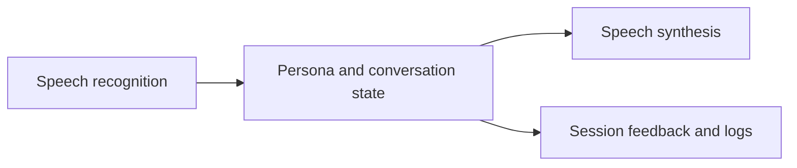

# Voice-based support training

## Walk through one training call

Audio moves through recognition, persona-driven conversation, speech synthesis, and feedback. The module boundaries under [src/](src/) keep those responsibilities visible, while [config/personas/](config/personas/) supplies the training scenarios.

The Streamlit interface and command-line entry point are two ways to exercise the same training idea. Treat latency, interruption handling, and failed recognition as part of the interaction; any quality claim needs evaluated recordings and a defined scoring rubric. Use synthetic scenarios when sharing a demonstration.



## Try a training scenario

```sh
python -m venv .venv
. .venv/bin/activate
python -m pip install -r requirements.txt
cp .env.example .env
# Fill in the provider settings used by your chosen scenario.
python main.py
```

For the browser interface, use `streamlit run streamlit_app.py` from the same environment. Audio-device and speech-provider prerequisites are described in the [implementation guide](docs/implementation-guide.md).

## Verify the boundaries

The existing `tests/` suite covers voice-pipeline, state, logging, and feedback behavior. Run it with `pytest` after installing the test dependencies described in the guide. Mocked providers establish application behavior; evaluated recordings are needed for latency and training-quality claims.

See the [detailed guide](docs/implementation-guide.md) for configuration, module responsibilities, and additional examples.
